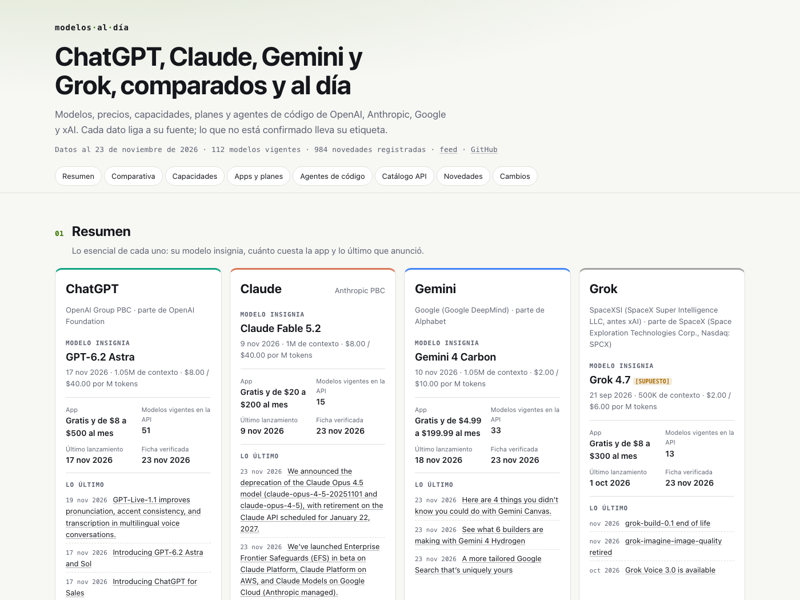
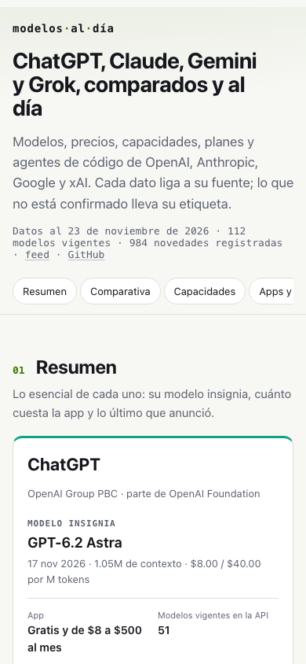

<p align="center">
  <a href="https://pivotek.mx"></a>
</p>

<p align="center">
  <b>Español</b> · <a href="README.en.md">English</a>
</p>

# modelos·al·día

[](https://github.com/BEG-lag/modelos-al-dia/actions/workflows/update.yml)
[](https://github.com/BEG-lag/modelos-al-dia/actions/workflows/ci.yml)


**ChatGPT (OpenAI), Claude (Anthropic), Gemini (Google) y Grok (xAI, hoy parte de SpaceX),
comparados y al día.** Modelos, precios de API, capacidades, planes de las apps, agentes de código
(Claude Code, Codex, Antigravity, Copilot, Cursor y más) y las novedades oficiales de cada empresa.
Cada dato liga a su fuente; lo que no está confirmado lleva su etiqueta.

**Sitio:** [beg-lag.github.io/modelos-al-dia](https://beg-lag.github.io/modelos-al-dia/) ·
**Tablas en GitHub:** [`TABLAS.md`](TABLAS.md) · **Feed:** [`feed.xml`](https://beg-lag.github.io/modelos-al-dia/feed.xml) ·
**Datos:** [`data/`](data)

| Escritorio | Teléfono |
| --- | --- |
|  |  |

## Contenido

| # | Sección | Qué responde | Cómo se actualiza | Estatus |
|---|---|---|---|---|
| 01 | [Resumen](https://beg-lag.github.io/modelos-al-dia/#resumen) | Modelo insignia, precio de la app y lo último de cada uno | Ficha curada + automático | 🟢 VERDE |
| 02 | [Comparativa por categoría](https://beg-lag.github.io/modelos-al-dia/#comparativa) | Insignia, razonamiento, rápido, código, imagen, video, voz, abiertos | Ficha curada | 🟢 VERDE |
| 03 | [Qué puede hacer cada uno](https://beg-lag.github.io/modelos-al-dia/#capacidades) | 14 capacidades: búsqueda, investigación, imagen, video, voz, agentes, MCP... | Ficha curada | 🟢 VERDE |
| 04 | [Apps y planes](https://beg-lag.github.io/modelos-al-dia/#planes) | Precio mensual de cada plan y qué incluye | Ficha curada | 🟡 AMARILLO: xAI con planes [SUPUESTO] (x.ai bloquea la lectura automática) |
| 05 | [Agentes de código](https://beg-lag.github.io/modelos-al-dia/#agentes) | Claude Code, Codex, Antigravity, Gemini CLI, Jules, Grok Build, Copilot, Cursor, Devin, Kiro, Cline, OpenCode | Ficha curada + versiones diarias de GitHub | 🟡 AMARILLO: varias celdas en [BRECHA DE DATO] |
| 06 | [Catálogo de la API](https://beg-lag.github.io/modelos-al-dia/#catalogo) | Todos los modelos con contexto, salida, precios y modalidades | Automático, dos veces al día | 🟢 VERDE |
| 07 | [Novedades oficiales](https://beg-lag.github.io/modelos-al-dia/#novedades) | Notas de versión de las 4 APIs y blogs de producto | Automático, dos veces al día | 🟡 AMARILLO: el blog de xAI no se puede leer; se cubre con sus notas de la API |
| 08 | [Cambios del catálogo](https://beg-lag.github.io/modelos-al-dia/#cambios) | Modelos nuevos, retirados y cambios de precio o contexto | Automático | 🟢 VERDE (empieza a registrar desde la primera corrida) |

## Cómo se mantiene al día

```
                    dos veces al día (GitHub Actions)                 cada lunes
 models.dev ─┐                                              ┌─ Claude revisa fichas
 OpenRouter ─┼─► data/catalogo.json ─► data/cambios.json    │  contra fuentes oficiales
 notas API  ─┼─► data/novedades.json                        │          │
 blogs      ─┤                                              │          ▼
 GitHub     ─┴─► data/agentes.json                          │   pull request ─► tú apruebas
                         │                                  │          │
                         ▼                                  │          ▼
          modelos-al-dia build ─► docs/ (sitio) + TABLAS.md ◄── data/curado/*.yaml
```

1. **Automático** (`.github/workflows/update.yml`, 07:00 y 19:00 de CDMX). Lee fuentes abiertas que no
   piden llave de API, actualiza `data/`, reconstruye el sitio y hace commit solo si algo cambió.
   Una fuente que falla se salta y se conserva lo guardado.
2. **Curado** (`data/curado/*.yaml`). Lo que ninguna API publica: planes, capacidades, modelos destacados
   por categoría y agentes de código. Cada dato con fuente y fecha de verificación.
3. **Curaduría semanal** (`.github/workflows/curar.yml`, lunes 08:00). Claude lee las novedades y cambios
   de la semana, verifica en las fuentes oficiales, edita las fichas y **abre un pull request**. Nada se
   publica sin aprobación. Requiere el secreto `ANTHROPIC_API_KEY`; sin él, el job se salta.

### Fuentes automáticas

| Fuente | Qué aporta | URL |
|---|---|---|
| models.dev (MIT) | Catálogo: fechas, contexto, salida, precios, modalidades, obsoletos | `https://models.dev/api.json` |
| OpenRouter | Confirma disponibilidad y suma modelos que models.dev no tiene | `https://openrouter.ai/api/v1/models` |
| OpenAI | Changelog de la API y blog (categorías de producto) | `developers.openai.com/api/docs/changelog.md`, `openai.com/news/rss.xml` |
| Anthropic | Notas de versión de Claude Platform y notas de `/news` | `docs.claude.com/en/release-notes/overview.md`, `anthropic.com/sitemap.xml` |
| Google | Notas de versión de la API de Gemini y blog de Gemini | `ai.google.dev/gemini-api/docs/changelog.md.txt`, `blog.google/products/gemini/rss/` |
| xAI | Notas de versión de la API | `docs.x.ai/docs/release-notes.md` |
| GitHub | Versiones de Claude Code, Codex, Gemini CLI, Grok Build, Cline y OpenCode | `github.com/<repo>/releases.atom` |

Los títulos de las novedades se guardan en el idioma original. No hay resúmenes generados con IA.

## Etiquetas de datos

- **[ESTIMADO]**: cifra calculada o aproximada.
- **[SUPUESTO]**: premisa no confirmada en una fuente oficial.
- **[BRECHA DE DATO]**: información que falta y hay que conseguir.

Las dudas abiertas de cada ficha están en su sección `pendientes` y al final de la página.

## Uso local

```bash
uv sync
uv run modelos-al-dia update     # lee las fuentes y actualiza data/
uv run modelos-al-dia build      # reconstruye docs/ y TABLAS.md
uv run modelos-al-dia check      # valida las fichas de data/curado
uv run pytest                    # pruebas sin red, con fixtures grabados
```

Para editar una ficha a mano: cambia el YAML de `data/curado/`, corre `check` y `build`, y haz commit.

## Estructura

```
data/
  catalogo.json      catálogo automático (models.dev + OpenRouter)
  cambios.json       eventos detectados entre corridas
  novedades.json     notas oficiales desde 2025
  agentes.json       versiones de agentes de código en GitHub
  curado/*.yaml      fichas curadas (una por proveedor y una de agentes de código)
docs/                sitio estático publicado en GitHub Pages (generado)
TABLAS.md            las mismas comparativas en markdown (generado)
src/modelos_al_dia/  código: fuentes, catálogo, novedades, sitio, tablas
tests/               pruebas con respuestas reales grabadas
```

## Aviso

Proyecto independiente, sin relación con OpenAI, Anthropic, Google ni xAI/SpaceX. Las marcas son de
sus dueños. Los precios y capacidades cambian sin aviso: antes de comprar o integrar, verifica en la
página oficial que liga cada dato. Esto no constituye asesoría legal, fiscal ni de compras.

Código bajo [MIT](LICENSE); datos propios bajo [CC0](DATA-LICENSE.md).
